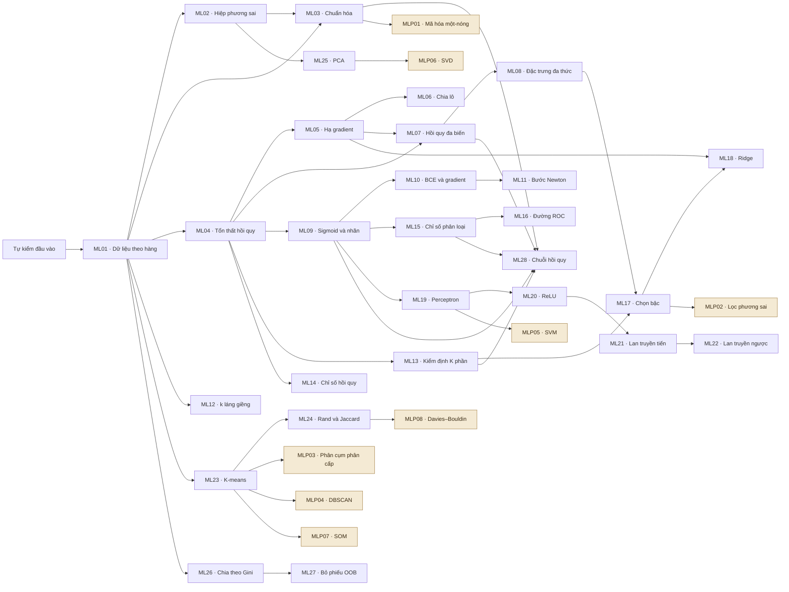

# Sơ đồ lộ trình học

Mỗi mũi tên trong sơ đồ nối một bài tiên quyết với bài sử dụng kiến thức đó. Các ô màu vàng là bài bổ sung.

### Các tuyến học

- **Nền tảng dữ liệu** · [ML01 Dữ liệu theo hàng](../../bai-hoc/ML01.md) → [ML02 Hiệp phương sai](../../bai-hoc/ML02.md) → [ML03 Chuẩn hóa](../../bai-hoc/ML03.md) → [MLP01 Mã hóa một-nóng](../../bai-hoc/MLP01.md)

- **Hồi quy và tối ưu** · [ML01 Dữ liệu theo hàng](../../bai-hoc/ML01.md) → [ML04 Tổn thất hồi quy](../../bai-hoc/ML04.md) → [ML05 Hạ gradient](../../bai-hoc/ML05.md) → [ML06 Chia lô](../../bai-hoc/ML06.md)

- **Hồi quy đa biến** · [ML04 Tổn thất hồi quy](../../bai-hoc/ML04.md) → [ML05 Hạ gradient](../../bai-hoc/ML05.md) → [ML07 Hồi quy đa biến](../../bai-hoc/ML07.md) → [ML08 Đặc trưng đa thức](../../bai-hoc/ML08.md)

- **Logistic và Newton** · [ML04 Tổn thất hồi quy](../../bai-hoc/ML04.md) → [ML09 Sigmoid và nhãn](../../bai-hoc/ML09.md) → [ML10 BCE và gradient](../../bai-hoc/ML10.md) → [ML11 Bước Newton](../../bai-hoc/ML11.md)

- **Phân loại theo khoảng cách** · [ML01 Dữ liệu theo hàng](../../bai-hoc/ML01.md) → [ML12 k láng giềng](../../bai-hoc/ML12.md)

- **Đánh giá hồi quy** · [ML04 Tổn thất hồi quy](../../bai-hoc/ML04.md) → [ML14 Chỉ số hồi quy](../../bai-hoc/ML14.md)

- **Đánh giá phân loại** · [ML09 Sigmoid và nhãn](../../bai-hoc/ML09.md) → [ML15 Chỉ số phân loại](../../bai-hoc/ML15.md) → [ML16 Đường ROC](../../bai-hoc/ML16.md)

- **Chọn và điều chuẩn mô hình** · [ML13 Kiểm định K phần](../../bai-hoc/ML13.md) → [ML17 Chọn bậc](../../bai-hoc/ML17.md) → [ML18 Ridge](../../bai-hoc/ML18.md)

- **Lọc đặc trưng** · [ML17 Chọn bậc](../../bai-hoc/ML17.md) → [MLP02 Lọc phương sai](../../bai-hoc/MLP02.md)

- **Mạng nơron** · [ML09 Sigmoid và nhãn](../../bai-hoc/ML09.md) → [ML19 Perceptron](../../bai-hoc/ML19.md) → [ML20 ReLU](../../bai-hoc/ML20.md) → [ML21 Lan truyền tiến](../../bai-hoc/ML21.md) → [ML22 Lan truyền ngược](../../bai-hoc/ML22.md)

- **Biên phân loại** · [ML19 Perceptron](../../bai-hoc/ML19.md) → [MLP05 SVM](../../bai-hoc/MLP05.md)

- **Phân cụm và đánh giá** · [ML01 Dữ liệu theo hàng](../../bai-hoc/ML01.md) → [ML23 K-means](../../bai-hoc/ML23.md) → [ML24 Rand và Jaccard](../../bai-hoc/ML24.md) → [MLP08 Davies–Bouldin](../../bai-hoc/MLP08.md)

- **Phân cụm mở rộng** · [ML23 K-means](../../bai-hoc/ML23.md) → [MLP03 Phân cụm phân cấp](../../bai-hoc/MLP03.md) / [ML23 K-means](../../bai-hoc/ML23.md) → [MLP04 DBSCAN](../../bai-hoc/MLP04.md) / [ML23 K-means](../../bai-hoc/ML23.md) → [MLP07 SOM](../../bai-hoc/MLP07.md)

- **Giảm chiều** · [ML02 Hiệp phương sai](../../bai-hoc/ML02.md) → [ML25 PCA](../../bai-hoc/ML25.md) → [MLP06 SVD](../../bai-hoc/MLP06.md)

- **Cây và tổ hợp** · [ML01 Dữ liệu theo hàng](../../bai-hoc/ML01.md) → [ML26 Chia theo Gini](../../bai-hoc/ML26.md) → [ML27 Bỏ phiếu OOB](../../bai-hoc/ML27.md)

- **Bài tổng hợp** · [ML28 Chuỗi hồi quy](../../bai-hoc/ML28.md)

Để vào ML28, hoàn thành ML03, ML07, ML09, ML13 và ML15.
